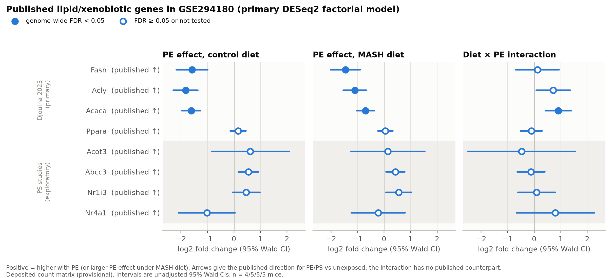
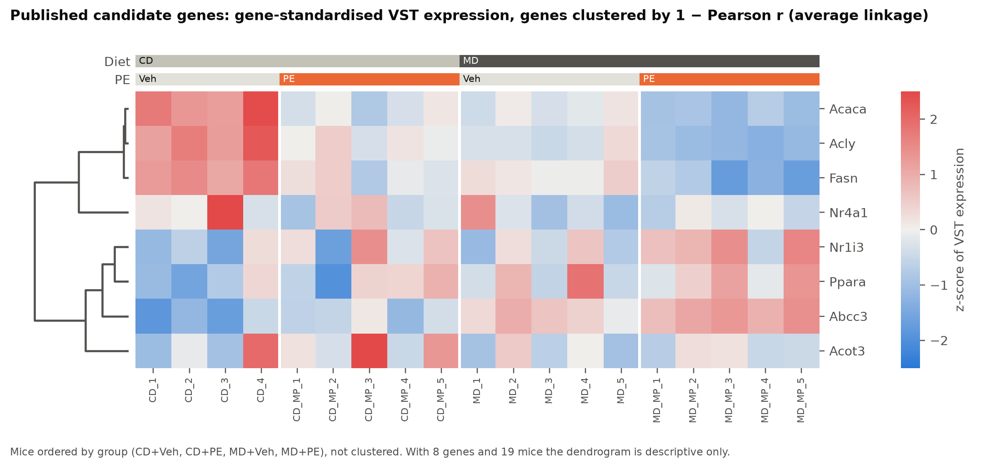
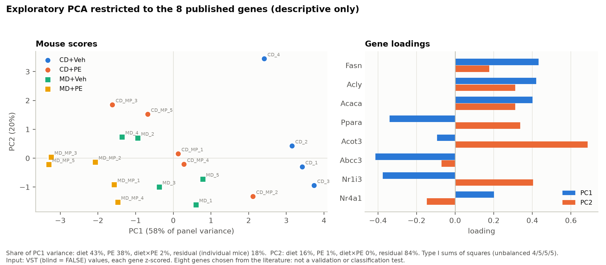

# Do published microplastic liver genes replicate in GSE294180?

**BT3041 cross-study replication: methods, findings, uncertainty and literature comparison**

> **Status: draft for team review.** Claude Code generated the code, numbers and text. The
> team has not yet checked them. All results use the **deposited GEO count matrix**
> (provisional, assumptions A1–A3 in `reports/final_report_draft.md`). This report adds no
> hypotheses. Where the evidence suggests a next question, it says so and leaves the
> decision to the team. Pathway enrichment was deliberately **not** run.

---

## 0. Summary

### Verified results (computed, robust to every check run here)

1. **Fasn, Acly and Acaca are lower with PE, under both diets. Djouina 2023 reported them
   higher.** Under the control diet, PE lowers them 3.0- to 3.5-fold (log2FC −1.58, −1.82,
   −1.61; genome-wide FDR ≤ 2 × 10⁻⁵). Under the MASH diet the drop is 1.6- to 2.7-fold
   (FDR ≤ 0.004). All 19 leave-one-mouse-out refits keep the direction and significance.
   So do the muscle-adjusted, clock-adjusted and drop-MD_1 fits. In the terms of the brief,
   this is *opposite direction, statistically supported*.
2. **What this shows: the published direction does not replicate in these mice.** It does
   **not** show that Djouina was wrong, or that PE lowers lipogenic genes in general. The
   two studies differ in sex, polymer source and size, route, dose, diet, assay and time
   point (§7). A same-dataset check also agrees: Jung 2026 reported these genes down in
   these very mice. That is **reproducibility, not replication**.
3. **Ppara shows no detectable within-diet PE effect** (control diet +0.16 [−0.14, 0.45];
   MASH diet +0.05 [−0.23, 0.33]). The 95% CIs exclude changes larger than about 1.4-fold
   up. Djouina's headline "two-fold" Ppara rise lies outside that interval.
4. **The Djouina Ppara claim is weaker than its text says.** Fig. 1B (6 wk) shows the
   ~2-fold rise only in the combined-bead group, which received double the particle mass.
   The 116 µm beads alone gave a *significant decrease* (~0.74×), and the 36 µm beads gave
   no change. The text describes an increase "after exposure to both types of PE microbeads".
   We read this from the figure directly (§3).

### Exploratory findings (suggestive, not established)

- **Abcc3 and Nr1i3 (PS panel) are higher with PE in both diets** (+0.43 to +0.55 log2),
  the direction Li 2025 reported. Within each diet the result is inconclusive by the
  primary criterion (genome-wide FDR 0.05–0.30). The additive model pools both diets and
  gives FDR 0.005 and 0.042. **Both lose significance after depth or yield adjustment.**
  The standard errors roughly double, and Nr1i3 also shrinks towards zero. Those
  covariates are 72–76% explained by PE itself (§6.3), so this neither confirms nor refutes
  a PE effect.
- **Acaca shows a nominal diet × PE interaction:** PE lowers it less under MASH diet
  (+0.91 log2; Wald FDR 0.038; LRT FDR 0.051). This is **not robust**. Significance is
  lost in 13 of 19 leave-one-out refits and under the muscle covariate (FDR 0.48). The
  estimate itself is stably positive: it keeps its sign in all 19 refits and all 2000
  bootstrap draws (§6.2). The diet itself already lowers Acaca
  2.9-fold, so a log-scale interaction may partly reflect a floor rather than a
  diet-specific PE response.
- **Gene clustering:** the three lipogenic genes always cluster together, and so do Ppara,
  Abcc3, Nr1i3 and Acot3. This held across all distance measures and linkages tried. Much
  of the co-expression is shared response to diet and PE. Some survives with group means
  removed (§7).

### Unsupported claims (what the data do not support)

- That PE effects in this dataset **replicate** any of the published increases in Fasn,
  Acly, Acaca or Ppara.
- That Acot3 or Nr4a1 change with PE. Their intervals are very wide: Acot3 spans −0.85 to
  +2.08 log2. Nr4a1 is lowly expressed (baseMean 56) and was removed by DESeq2's
  independent filtering in one contrast. **Non-significance here is lack of evidence, not
  evidence of no effect** (§4.4).
- That the MASH diet changes the PE response of any panel gene. The only nominal case,
  Acaca, is not robust.
- That the lipid genes form a **pathway** or a **mechanism**. Eight literature-chosen genes
  cannot show that (§7).

### Main limitations

- n = 4/5/5/5 mice. Cage is the same as group (one cage per group). The design is
  unblinded and the batch structure is unknown.
- PE is almost perfectly aligned with lower sequencing depth and yield. The CD+Veh group
  has a distinct circadian/feeding state. Fasn, Acly and Acaca are strongly diurnal and
  feeding-regulated genes.
- The genes were checked **after** a preliminary look at these data showed opposite signs.
  This report uses genome-wide FDR as its primary criterion partly for that reason (§2.3).
- The Nr4a1 primary source (Chiu 2025) could only be read as an abstract.

---

## 1. Data and model

| Item | Value |
|---|---|
| Data | GSE294180 deposited gene-level counts; 19 male C57BL/6 mice; 13,777 genes after the Phase 2 pre-filter |
| Groups | CD+Veh 4, CD+PE 5, MD+Veh 5, MD+PE 5; 8 weeks; 2 mg PE (10–150 µm)/mouse/day by gavage |
| Primary model | DESeq2 `~ diet + microplastic + diet:microplastic`, references CD and Veh (`results/deseq2/provisional_deposited/`, unchanged) |
| Contrasts used | PE_in_CD, PE_in_MD, Diet_in_Veh, Interaction (existing outputs), plus the additive-model PE main effect (new) |
| Effect scale | log2 fold change; 95% CI = log2FC ± 1.96 × SE (Wald, unadjusted) |
| Expression level | DESeq2 baseMean and group means of size-factor-normalised counts (`gene_replication_results.csv`) |

### 1.1 The gene panels

| Panel | Genes | Published direction | Source and verification |
|---|---|---|---|
| Primary (pre-specified by the team) | Fasn, Acly, Acaca, Ppara | up | Djouina 2023, PE, female, qPCR; **full text + Fig. 1 read** |
| Exploratory | Acot3, Abcc3, Nr1i3 | up | Li 2025, PS, male ICR, RNA-seq + qPCR; **full text read** (Fig. 8 asterisks and supplement not read) |
| Exploratory | Nr4a1 | up | Chiu 2025, PS; **abstract only**. Supported by a full-text qPCR study (Front Pharmacol 2025; ~7.5-fold up) |

All claims, contexts and verification levels are in `published_gene_evidence.csv`.

---

## 2. How "agreement" is judged

### 2.1 Which of our contrasts maps onto a published claim

Every published claim compares exposed with unexposed mice on a non-metabolic-stress diet.
So:

- **PE_in_CD** is the closest analogue.
- **PE_in_MD** is a partial analogue. Our MASH diet has no counterpart in those studies.
- **Diet_in_Veh** and **Interaction** have **no** published counterpart. Their direction
  agreement is "not assessable", but their estimates are still reported.

Even PE_in_CD is not like-for-like. Our control diet is a purified, sucrose-matched diet
(D09100304), not chow, and our control mice received a Tween-20 gavage.

### 2.2 The five categories

| Category | Rule (primary) |
|---|---|
| Same direction, statistically supported | sign matches the published direction **and** genome-wide BH-FDR < 0.05 |
| Opposite direction, statistically supported | sign opposite **and** genome-wide BH-FDR < 0.05 |
| Same direction, statistically inconclusive | sign matches, FDR ≥ 0.05 |
| Opposite direction, statistically inconclusive | sign opposite, FDR ≥ 0.05 |
| Not assessable | no published direction for this contrast, or no adjusted p-value (independent filtering) |

A matching sign on its own is never counted as replication. A sign is a coin toss under
the null: even with no true effect, half of all genes would "agree".

### 2.3 Which multiple-testing correction, and why

Two corrections are reported side by side:

- **Primary: genome-wide BH-FDR within each contrast.** This is the existing DESeq2
  `padj`, over about 13,000 tested genes.
- **Secondary: Holm within each panel.** This is a familywise correction over 4 genes per
  contrast, using the raw p-values. It would be the right family for a panel truly fixed
  in advance.

The genome-wide criterion is primary because the decision to test these genes was not
independent of these data. The team's preliminary analysis had already noticed opposite
signs, and Jung 2026 had already reported Fasn and Acly down in these mice. A
4-gene correction would treat the panel as if it were chosen blind, which overstates the
evidence. The two corrections disagree in only two cells:

- **Abcc3, PE_in_CD:** genome-wide 0.051 (inconclusive) vs panel Holm 0.019 (supported).
- **Nr4a1, PE_in_CD:** filtered genome-wide (not assessable) vs Holm 0.18 (inconclusive).

---

## 3. Part 1 — Verifying the published claims

**Djouina et al. 2023** (Ecotoxicol Environ Saf 264:115417) was read from the publisher
PDF. Fig. 1B–C was rendered at 400 dpi and read directly. The figure prints no numeric
values, so the fold changes below are read by eye from the bars (±0.1).

| Gene | 6 weeks (RB 36 µm / GB 116 µm / RB+GB) | 9 weeks (RB / GB / RB+GB) | What the text says |
|---|---|---|---|
| Fasn | ~3.2* / ~2.6** / ~1.95* | ~1.25 / ~1.05 / ~0.85, **none significant** | "significantly upregulated in all groups" (6 wk) |
| Acly | ~2.1* / ~3.3** / ~2.6** | ~1.9 / ~1.65 / ~2.35**, **RB+GB only** | same sentence as Fasn (6 wk) |
| Acaca | ~1.65** / ~2.7*** / ~2.0** | ~1.9 / ~2.05 / ~1.95, **all significant** | up at both time points |
| Ppara | ~0.96 (ns) / **~0.74* (down)** / ~1.93* | ~1.02 / ~1.32* / ~1.69*** | "two-fold increase … after exposure to both types" |

Design: female C57BL/6, n = 10/group, beads mixed into food at 100 µg/g per bead type. The
test was Mann–Whitney U vs control at p < 0.05, with **no multiple-testing correction**.
There was no vehicle or inert-particle control. Primers are "available upon request".

**What this verification changes:**

- Only **Acaca** was up in every PE group at both time points.
- The Fasn rise did not persist to 9 weeks.
- The Ppara rise was confined to the combined group (6 wk) or to the larger beads
  (9 wk). At 6 weeks the larger beads alone lowered Ppara.

So "PE induces Ppara two-fold" is a fair summary of the combined-bead arm only.

**Li et al. 2025** (Sci Rep 15:2583, PMC11747203) was read in full. Acot3, Abcc3, Nr1i3
and Fmo2 were picked as "hub genes" by network topology (CytoHubba) among 87 DEGs shared
by three PS sizes vs water. The first three were confirmed up by qPCR (n = 5–6; one-way
ANOVA + LSD, which is uncorrected). Fmo2 was not confirmed. **No numeric fold changes
are given**, and per-size significance is shown only as asterisks in Fig. 8, which were
not read. Hub status is a computational prediction; only the mRNA changes were validated.

**Nr4a1.** Chiu et al. 2025 (Environ Pollut 369:125850) is the only PS liver study whose
central claim is Nr4a1 upregulation. Only its abstract was accessible: n, sex, strain,
particle size, dose and statistics are all unknown. A full-text qPCR study (Front
Pharmacol 2025; male Swiss mice, ~1.8 µm PS, 10 mg/kg/day gavage, 60 days) reports
Nr4a1 ~7.5-fold up. **The team should obtain Chiu 2025 in full before relying on it.**

---

## 4. Part 2 — Hypothesis testing (BT3041 Topic 2)

| | |
|---|---|
| **Concept** | Wald tests of pre-defined contrasts in a fitted GLM; confidence intervals; multiple-testing control (BH-FDR, Holm) |
| **Why appropriate** | Each published claim is a statement about one contrast's sign, so it is a one-parameter question. The CI shows effect size and uncertainty, not just a verdict. |
| **Biological question** | In these mice, does PE shift each gene in the published direction, by more than noise? |
| **Establishes** | Whether the data are compatible with no PE effect for each gene, and how large an effect the data allow |
| **Cannot establish** | That PE *causes* the change (PE is aligned with depth and cage). Why studies disagree. That a non-significant gene is unaffected. |

### 4.1 Null hypotheses

For gene *g* and contrast *c*, with *β* the log2 fold change from the factorial model:

- PE_in_CD: H₀: β_PE = 0. The CD+PE and CD+Veh means are equal.
- PE_in_MD: H₀: β_PE + β_diet×PE = 0. The MD+PE and MD+Veh means are equal.
- Interaction: H₀: β_diet×PE = 0. The PE effect is the same under both diets (§5).

Each test is two-sided. A published direction is never used to make a test one-sided,
because the question is whether the data agree, not whether they confirm.

### 4.2 Results (PE contrasts)

log2FC [95% CI]; genome-wide BH-FDR in parentheses. Full table: `gene_replication_results.csv`.

| Gene (published) | baseMean | PE, control diet | PE, MASH diet | PE, additive (both diets) | Category (PE_in_CD / PE_in_MD) |
|---|---|---|---|---|---|
| **Fasn** (↑) | 15,828 | −1.58 [−2.17, −0.99] (2 × 10⁻⁵) | −1.46 [−2.02, −0.90] (8 × 10⁻⁵) | −1.51 [−1.87, −1.16] | Opposite, supported / Opposite, supported |
| **Acly** (↑) | 6,271 | −1.82 [−2.28, −1.36] (2 × 10⁻¹¹) | −1.10 [−1.54, −0.67] (2 × 10⁻⁴) | −1.45 [−1.79, −1.10] | Opposite, supported / Opposite, supported |
| **Acaca** (↑) | 2,533 | −1.61 [−1.96, −1.26] (2 × 10⁻¹⁵) | −0.70 [−1.03, −0.37] (0.004) | −1.13 [−1.44, −0.83] | Opposite, supported / Opposite, supported |
| **Ppara** (↑) | 1,086 | +0.16 [−0.14, +0.45] (0.62) | +0.05 [−0.23, +0.33] (0.92) | +0.10 [−0.10, +0.30] | Same, inconclusive / Same, inconclusive |
| Acot3 (↑) | 107 | +0.62 [−0.85, +2.08] (0.71) | +0.14 [−1.24, +1.53] (0.95) | +0.37 [−0.62, +1.35] | Same, inconclusive / Same, inconclusive |
| Abcc3 (↑) | 2,751 | +0.55 [+0.17, +0.93] (0.051) | +0.43 [+0.07, +0.78] (0.19) | +0.48 [+0.23, +0.74] (0.005) | Same, inconclusive / Same, inconclusive |
| Nr1i3 (↑) | 2,384 | +0.47 [−0.05, +0.98] (0.30) | +0.55 [+0.07, +1.04] (0.22) | +0.51 [+0.17, +0.86] (0.042) | Same, inconclusive / Same, inconclusive |
| Nr4a1 (↑) | 56 | −1.02 [−2.08, +0.04] (filtered) | −0.22 [−1.24, +0.79] (0.90) | −0.61 [−1.35, +0.13] | Not assessable / Opposite, inconclusive |

*Forest plot. Each point is the log2FC with its 95% Wald CI. Filled points are genome-wide
FDR < 0.05. The arrow in each label is the published direction.*

### 4.3 Category counts (primary criterion)

| Category | PE_in_CD | PE_in_MD | Additive PE |
|---|---|---|---|
| Same direction, supported | 0 | 0 | 2 (Abcc3, Nr1i3) |
| Opposite direction, supported | 3 (Fasn, Acly, Acaca) | 3 | 3 |
| Same direction, inconclusive | 4 | 4 | 2 |
| Opposite direction, inconclusive | 0 | 1 (Nr4a1) | 1 (Nr4a1) |
| Not assessable | 1 (Nr4a1, filtered) | 0 | 0 |

The additive-model row assumes no interaction. It is a pooled estimate, valid only to the
extent that §5 finds no diet-dependence, and it was not pre-specified as primary.

### 4.4 Multiple testing and why "non-significant" is not "no effect"

**Why correct.** Each contrast tests about 13,000 genes. At p < 0.05 with no correction,
about 650 would be "significant" by chance even if PE did nothing. BH controls the
expected share of false discoveries among the genes called. Holm controls the chance of
any false call within a small panel.

Djouina tested about 50 qPCR targets × 3 groups × 2 time points with no correction, and
Li 2025 used LSD. Their individual gene calls carry more false-positive risk than ours,
though the large Fasn, Acly and Acaca effects in Djouina would probably survive a
correction.

**Why non-significance is not absence.** A test that fails to reject H₀ can mean no
effect, or an effect too small or noisy to detect with 4–5 mice. The CI tells the two
apart:

- **Ppara is informative.** Its CI under control diet (−0.14 to +0.45 log2, i.e. 0.91×
  to 1.37×) rules out Djouina's two-fold rise at the 95% level. So the data argue
  *against* a large Ppara effect, not merely fail to find one. They cannot rule out a
  rise of up to ~1.4-fold.
- **Acot3 and Nr4a1 are uninformative.** Their CIs span from a halving to a four-fold
  increase. Nothing can be concluded either way. Their ashr-shrunk estimates (+0.03 and
  −0.10) show how little information the data hold.
- **Abcc3 and Nr1i3 lean towards the published direction.** Their CIs mostly lie above
  zero. Adjustment for depth or yield removes them (§6.3), so they stay exploratory.

---

## 5. Part 3 — Regression and interactions (BT3041 Topic 4)

| | |
|---|---|
| **Concept** | Two-factor linear model with an interaction term; nested-model comparison (likelihood-ratio test, F-test, AIC, adjusted R²) |
| **Why appropriate** | The design is a 2 × 2 factorial. The interaction is the formal test of whether the PE effect depends on diet. None of the 9 factorial microplastic studies in the team's literature review tested it. |
| **Biological question** | Is the PE-associated change in each gene different in a MASH-diet liver from a control-diet liver? |
| **Establishes** | The size of the difference between the two PE effects, with uncertainty; whether the extra parameter is warranted |
| **Cannot establish** | A biological mechanism of "exacerbation" or "protection". Interactions on the log scale depend on the scale and can reflect floors or ceilings. |

### 5.1 What each term means

Model: log2(mean expression) = β₀ + β_diet·MD + β_PE·PE + β_diet×PE·(MD·PE)

| Term | Meaning |
|---|---|
| β₀ (intercept) | Mean expression of CD+Veh mice (reference cell) |
| β_diet | MASH diet vs control diet, **in vehicle mice** (Diet_in_Veh) |
| β_PE | PE vs vehicle **under control diet** (PE_in_CD). Not an "overall" PE effect. |
| β_diet×PE | How much the PE effect under MASH diet differs from the PE effect under control diet: (MD+PE − MD+Veh) − (CD+PE − CD+Veh) |
| β_PE + β_diet×PE | PE effect under MASH diet (PE_in_MD) |

The **additive model** (`~ diet + PE`) drops β_diet×PE. It forces one PE effect, the same
in both diets.

### 5.2 Interaction estimates

Full table: `interaction_results.csv`. Two estimates are shown:

- **DESeq2 Wald** = negative-binomial GLM, log2 scale.
- **OLS** = ordinary least squares on VST values: the course-style two-way ANOVA, a check
  on the same question with a different error model.

| Gene | PE, CD | PE, MD | Interaction, DESeq2 [95% CI] | Wald FDR | LRT FDR | Interaction, OLS on VST [95% CI] | OLS F p |
|---|---|---|---|---|---|---|---|
| Fasn | −1.58 | −1.46 | +0.12 [−0.69, +0.94] | 0.97 | 0.97 | +0.12 [−0.76, +1.01] | 0.77 |
| Acly | −1.82 | −1.10 | +0.72 [+0.08, +1.35] | 0.47 | 0.47 | +0.72 [−0.02, +1.47] | 0.055 |
| **Acaca** | −1.61 | −0.70 | **+0.91 [+0.42, +1.39]** | **0.038** | 0.051 | +0.87 [+0.34, +1.40] | 0.003 |
| Ppara | +0.16 | +0.05 | −0.11 [−0.51, +0.30] | 0.94 | 0.94 | −0.07 [−0.47, +0.33] | 0.70 |
| Acot3 | +0.62 | +0.14 | −0.47 [−2.49, +1.55] | 0.95 | 0.95 | −0.29 [−1.38, +0.80] | 0.58 |
| Abcc3 | +0.55 | +0.43 | −0.12 [−0.64, +0.40] | 0.95 | 0.95 | −0.10 [−0.66, +0.47] | 0.72 |
| Nr1i3 | +0.47 | +0.55 | +0.09 [−0.61, +0.79] | 0.98 | 0.98 | +0.12 [−0.71, +0.95] | 0.76 |
| Nr4a1 | −1.02 | −0.22 | +0.80 [−0.67, +2.27] | 0.82 | 0.82 | +0.29 [−0.41, +1.00] | 0.39 |

**Reading the estimates, not counting significant genes:**

- **Seven of eight genes** have interaction estimates near zero. Their CIs include zero.
- **Fasn and Abcc3** are the clearest cases of a PE effect that looks the same under both
  diets. Their CIs exclude differences beyond about ±0.9 and ±0.6 log2.
- **Acaca:** the PE effect is smaller under MASH diet (−0.70 vs −1.61). The Wald test
  passes genome-wide FDR at 0.038. The equivalent LRT just misses at 0.051. **It does not
  survive leave-one-out (6/19 refits significant) or the muscle covariate (FDR 0.48)** —
  see §6.
- **Acly** shows the same pattern more weakly (raw p 0.028, FDR 0.47).

The diet alone already lowers Acly and Acaca 2.9- to 4.5-fold. A smaller PE effect on top
of an already low level is what a floor effect would also produce. The data cannot tell
that apart from a diet-specific PE response.

### 5.3 Additive vs factorial: is the interaction term warranted?

| Gene | OLS R², additive → factorial | adj. R², additive → factorial | AIC, additive → factorial | DESeq2 LRT p |
|---|---|---|---|---|
| Fasn | 0.856 → 0.856 | 0.837 → 0.828 | 27.2 → 29.1 | 0.76 |
| Acly | 0.882 → 0.909 | 0.868 → 0.890 | 25.2 → 22.4 | 0.027 |
| Acaca | 0.814 → 0.898 | 0.791 → 0.877 | 19.0 → 9.7 | 2.4 × 10⁻⁴ |
| Ppara | 0.223 → 0.230 | 0.125 → 0.077 | −2.9 → −1.1 | 0.61 |
| Acot3 | 0.160 → 0.178 | 0.056 → 0.014 | 35.4 → 37.0 | 0.65 |
| Abcc3 | 0.838 → 0.840 | 0.818 → 0.808 | 10.3 → 12.1 | 0.66 |
| Nr1i3 | 0.324 → 0.329 | 0.240 → 0.194 | 24.6 → 26.5 | 0.80 |
| Nr4a1 | 0.135 → 0.178 | 0.027 → 0.014 | 19.3 → 20.3 | 0.29 |

- **Plain R² always rises** when a term is added. That is arithmetic, not evidence. The
  added complexity is warranted only if it improves fit by more than chance would.
- That is checked with the nested-model **LRT/F-test** and penalised criteria
  (**adjusted R², AIC**).
- For six genes, the penalised criteria **prefer the simpler additive model**.
- Only Acaca (and marginally Acly) favour the factorial model. Even there, a better fit
  shows that the group means are not additive on this scale. **It is not evidence of a
  biological interaction** (see the floor argument above and the robustness checks in §6).
- Ppara, Acot3, Nr1i3 and Nr4a1 have low R² under both models (0.13–0.33). Most of their
  variation is between mice within a group, not between groups.
- OLS residuals look normal for every gene except Nr4a1 (Shapiro p = 0.02). Shapiro tests
  have little power at n = 19.

---

## 6. Part 4 — Model validation and robustness (BT3041 Topic 5)

| | |
|---|---|
| **Concept** | Case-deletion diagnostics (leave-one-out), resampling (bootstrap), sensitivity analysis to model specification |
| **Why appropriate** | With 4–5 mice per group, one unusual mouse can create or erase a result. Several technical variables are aligned with treatment. |
| **Biological question** | Is each gene-level conclusion a property of the group, or of one mouse or one technical factor? |
| **Establishes** | Which conclusions are stable to removing any single mouse and to plausible adjustments |
| **Cannot establish** | That a stable result is caused by PE. A confounder present in every PE mouse (depth, cage) is stable under leave-one-out too. |

### 6.1 Leave-one-mouse-out (19 refits)

Each mouse was dropped in turn. The full DESeq2 factorial model was refitted on all genes,
which includes re-estimating size factors, dispersions and the genome-wide FDR. These
refits already exist in `results/deseq2/loo/`. Per-refit values are in
`leave_one_out_results.csv`; the summary is `leave_one_out_summary.csv`.

| Gene | Contrast | Full log2FC | Same direction (of 19) | FDR < 0.05 (of 19) | LOO range | Most influential mouse (Δ / SE) |
|---|---|---|---|---|---|---|
| Fasn | PE_in_CD | −1.58 | 19 | 19 | −1.77 to −1.43 | CD_MP_2 (0.6) |
| Acly | PE_in_CD | −1.82 | 19 | 19 | −1.98 to −1.50 | CD_4 (1.4) |
| Acaca | PE_in_CD | −1.61 | 19 | 19 | −1.73 to −1.37 | CD_4 (1.3) |
| Ppara | PE_in_CD | +0.16 | 19 | 0 | +0.09 to +0.25 | CD_4 (0.7) |
| Acot3 | PE_in_CD | +0.62 | **18** | 0 | −0.07 to +1.98 | **CD_4 (1.8)** |
| Abcc3 | PE_in_CD | +0.55 | 19 | **3** | +0.42 to +0.78 | CD_4 (1.2) |
| Nr1i3 | PE_in_CD | +0.47 | 19 | 0 | +0.27 to +0.67 | CD_4 (0.8) |
| Nr4a1 | PE_in_CD | −1.02 | 18 | 0 | −1.29 to +0.03 | **CD_3 (1.9)** |
| Fasn | PE_in_MD | −1.46 | 19 | 19 | −1.65 to −1.33 | MD_MP_1 (0.7) |
| Acly | PE_in_MD | −1.10 | 19 | 19 | −1.18 to −0.91 | MD_5 (0.9) |
| Acaca | PE_in_MD | −0.70 | 19 | 19 | −0.76 to −0.63 | MD_5 (0.4) |
| Ppara | PE_in_MD | +0.05 | 18 | 0 | −0.00 to +0.16 | MD_4 (0.8) |
| Acot3 | PE_in_MD | +0.14 | 15 | 0 | −0.04 to +0.59 | MD_2 (0.6) |
| Abcc3 | PE_in_MD | +0.43 | 19 | 0 | +0.34 to +0.53 | MD_2 (0.6) |
| Nr1i3 | PE_in_MD | +0.55 | 19 | 0 | +0.46 to +0.69 | MD_MP_4 (0.5) |
| Nr4a1 | PE_in_MD | −0.22 | 18 | 0 | −0.42 to +0.45 | MD_1 (1.3) |
| **Acaca** | **Interaction** | +0.91 | 19 | **6** | +0.67 to +1.03 | CD_4 (1.0) |

- **No single mouse drives the Fasn, Acly or Acaca conclusions** in either diet.
- **CD_4 is the most influential mouse for most PE_in_CD estimates.** That is expected:
  it is one of only four CD+Veh references. Acot3 swings widely: removing CD_4 raises its
  estimate from +0.62 to +1.98, and removing CD_MP_3 lowers it to −0.07. A single mouse
  can therefore flip its sign.
- **The Acaca interaction is fragile.** Its estimate always stays positive (+0.67 to
  +1.03), but it passes genome-wide FDR in only 6 of 19 refits. Its significance is
  borderline, not driven by a single outlier.
- The Abcc3 PE_in_CD result crosses FDR 0.05 in 3 of 19 refits. It is a borderline result.

### 6.2 Exploratory stratified bootstrap

**Clearly labelled exploratory.**

- **Resampling scheme.** In each of 2000 draws (seed 20261121), mice were resampled with
  replacement **within each of the four groups**. This keeps the 2 × 2 structure and the
  group sizes (4/5/5/5).
- **What was held fixed.** Each mouse kept its own size factor. Dispersions were fixed at
  the primary fit's values: re-estimating them on resamples with duplicated mice would
  underestimate them. Only the coefficients were refitted.
- **Check.** Refitting the original data this way reproduces the primary estimates exactly.

Results are in `bootstrap_summary.csv`; the draws are in
`intermediate/bootstrap_panel.csv.gz`.

| Gene | PE, CD: 2.5–97.5% | Same sign | PE, MD: 2.5–97.5% | Same sign | Interaction: 2.5–97.5% | Same sign |
|---|---|---|---|---|---|---|
| Fasn | −2.10 to −1.10 | 100% | −2.01 to −1.02 | 100% | −0.60 to +0.80 | 62% |
| Acly | −2.38 to −1.22 | 100% | −1.47 to −0.79 | 100% | +0.02 to +1.36 | 98% |
| Acaca | −2.06 to −1.16 | 100% | −0.90 to −0.49 | 100% | +0.41 to +1.40 | 100% |
| Ppara | −0.12 to +0.42 | 86% | −0.21 to +0.30 | 66% | −0.46 to +0.28 | 71% |
| Acot3 | −1.09 to +2.82 | 74% | −0.73 to +1.18 | 63% | −2.81 to +1.53 | 67% |
| Abcc3 | +0.11 to +1.02 | 99% | +0.17 to +0.69 | 100% | −0.64 to +0.41 | 67% |
| Nr1i3 | −0.11 to +0.96 | 95% | +0.11 to +0.97 | 99% | −0.56 to +0.80 | 60% |
| Nr4a1 | −2.27 to +0.45 | 83% | −1.06 to +0.81 | 65% | −1.01 to +2.54 | 79% |

**Reading.**

- The bootstrap intervals are close to the Wald intervals for every gene. The
  model-based uncertainty is not grossly wrong.
- **The sign of the lipogenic decreases never changed in 2000 draws.**
- The Acaca interaction estimate also kept its sign in every draw. Together with the
  leave-one-out range (+0.67 to +1.03), this says the *estimate* is stably positive. What
  is fragile is whether it clears a **genome-wide** FDR threshold, and whether it survives
  the muscle covariate. The bootstrap says nothing about either.

**Limitations of this bootstrap.**

- With 4–5 mice per group, each resample contains only about 13 distinct mice out of 19
  (range 7–18). There are only a few hundred distinct resamples per group.
- Percentile intervals at this n are known to be **too narrow**, roughly by a factor of
  √((n−1)/n) ≈ 0.87–0.89.
- The resamples cannot represent mice unlike the ones observed.
- Fixing dispersions ignores their uncertainty.

So the bootstrap adds a check on sign stability. It is not a better interval than the
Wald CI, and it cannot replace more mice.

### 6.3 Comparison with existing covariate-adjusted fits

These refits already exist in `results/deseq2/`. Values in `covariate_sensitivity.csv`.

**How collinear is each covariate with the design?** The table gives R² of the covariate
on the 4 groups, and on the PE indicator alone.

| Covariate | R² on group | R² on PE alone |
|---|---|---|
| Sequencing depth | 0.78 | **0.76** |
| Yield (quality) proxy | 0.80 | **0.72** |
| Clock-phase score | 0.58 | 0.08 (aligned with CD+Veh instead) |
| Skeletal-muscle score | 0.39 | 0.13 |

PE log2FC (genome-wide FDR) by adjustment:

| Gene | Contrast | Primary | + depth | + yield | + muscle | + clock | − MD_1 |
|---|---|---|---|---|---|---|---|
| Fasn | PE_in_CD | −1.58 (<0.001) | −1.46 (**0.29**) | −1.83 (**0.22**) | −1.62 (<0.001) | −1.93 (<0.001) | −1.58 (<0.001) |
| Fasn | PE_in_MD | −1.46 (<0.001) | −1.37 (**0.18**) | −1.58 (0.012) | −1.33 (0.033) | −1.48 (<0.001) | −1.42 (0.001) |
| Acly | PE_in_CD | −1.82 (<0.001) | −2.19 (<0.001) | −2.32 (0.001) | −1.79 (<0.001) | −1.80 (<0.001) | −1.82 (<0.001) |
| Acly | PE_in_MD | −1.10 (<0.001) | −1.38 (0.008) | −1.34 (0.003) | −1.24 (0.002) | −1.10 (0.002) | −1.14 (0.007) |
| Acaca | PE_in_CD | −1.61 (<0.001) | −1.82 (<0.001) | −1.47 (0.023) | −1.56 (<0.001) | −1.52 (<0.001) | −1.61 (<0.001) |
| Acaca | PE_in_MD | −0.70 (0.004) | −0.85 (**0.078**) | −0.63 (**0.23**) | −0.89 (0.004) | −0.70 (0.003) | −0.76 (0.003) |
| Ppara | PE_in_CD | +0.16 (0.62) | −0.14 (0.95) | +0.13 (0.96) | +0.19 (0.55) | +0.41 (0.15) | +0.16 (0.64) |
| Abcc3 | PE_in_CD | +0.55 (0.051) | +0.49 (0.72) | +0.80 (0.56) | +0.53 (0.078) | +0.54 (0.23) | +0.55 (0.060) |
| Nr1i3 | PE_in_CD | +0.47 (0.30) | +0.27 (0.95) | +0.04 (0.99) | +0.49 (0.39) | +0.85 (0.16) | +0.47 (0.30) |

**Interpretation, with the confounding caveat.**

1. **The point estimates for Fasn, Acly and Acaca hardly move** under any adjustment
   (−1.3 to −2.3 log2 throughout). Where significance is lost after depth or yield
   adjustment, it is mainly because the standard errors inflate (1.4–2.0× for Fasn). With a covariate this
   collinear with PE, the model cannot tell "PE" apart from "low-depth library".
2. **Adjustment therefore cannot isolate a causal PE effect.** Including depth asks what
   PE does among libraries of equal depth, but almost no such libraries exist here: every
   PE library is shallower than every vehicle library. Not adjusting risks attributing a
   technical artefact to PE. Adjusting risks removing a real PE effect. Neither fit is
   "the truth". The honest statement is that the data are consistent with both.
3. **Clock phase is relevant because these genes are diurnal.** Fasn, Acly and Acaca are
   strongly controlled by feeding and the clock, and the CD+Veh reference has a distinct
   clock state. The **MASH-diet contrast does not use CD+Veh at all**, yet shows the same
   direction (−0.70 to −1.46). The clock-adjusted control-diet estimates are also as large
   or larger. So the CD+Veh clock state alone does not explain the lipogenic decrease.
   Sampling time per mouse is not reported in the deposited data, so this cannot be
   checked directly.
4. **Abcc3 and Nr1i3** keep their sign under every adjustment. Under depth or yield
   adjustment, Abcc3 keeps its size (+0.49 to +0.80) but its SE doubles, while Nr1i3
   shrinks to +0.04–0.27. Their PE association is entangled with library properties.

---

## 7. Part 5 — Hierarchical clustering (BT3041 Topic 9)

| | |
|---|---|
| **Concept** | Agglomerative hierarchical clustering; choice of distance (similarity) measure and linkage; cophenetic correlation |
| **Why appropriate** | It shows which published genes rise and fall together across mice, without assuming groups in advance |
| **Biological question** | Do the published lipid-metabolism genes form coherent co-expression groups in these livers? |
| **Establishes** | Which genes share an expression pattern across these 19 mice, and whether that grouping depends on the distance chosen |
| **Cannot establish** | A pathway, a regulatory relationship or a mechanism. With 8 hand-picked genes, any clustering is descriptive. |

**Input.** VST values from the primary fit (`blind = FALSE`). VST stabilises the
count-dependent variance so that highly and lowly expressed genes can be compared. Each
gene was then z-scored across the 19 mice, so clustering reflects the *pattern* of
expression, not its level. Without z-scoring, Fasn (baseMean ~16,000) would dominate
every distance.

**Distance measures compared** (`clustering_comparison.csv`):

| Distance | Average-linkage clusters at k = 3 | Cophenetic r |
|---|---|---|
| 1 − Pearson r (primary) | {Fasn, Acly, Acaca} · {Nr4a1} · {Ppara, Acot3, Abcc3, Nr1i3} | 0.91 |
| 1 − Spearman ρ | same | 0.93 |
| Euclidean on z-scores | same | 0.95 |
| 1 − within-group Pearson r (group means removed) | same | 0.92 |

**Which measure is appropriate:**

- **1 − Pearson correlation** is the natural choice for "do these genes go up and down
  together?". It ignores level and scale, which z-scoring already removed.
- On z-scored data, squared **Euclidean distance** equals 2(n − 1)(1 − r). It is therefore
  a monotone transform of the Pearson distance and gives the same tree. Its slightly
  higher cophenetic r is not evidence that it is better.
- **Spearman** is the robust alternative when one mouse is extreme. It gives the same
  answer here.
- Complete linkage splits off Acot3 at k = 3. Acot3 is the noisiest gene (baseMean 107),
  so its position is the least stable.

*Heatmap. Gene-standardised VST expression; genes clustered by 1 − Pearson r, average
linkage. Mice are ordered by group, not clustered.*

**Do the lipid genes form coherent groups?** Descriptively, yes:

- The three lipogenic genes correlate at r = 0.91–0.94 across mice.
- Ppara correlates with Nr1i3 (r = 0.79) and Abcc3 (r = 0.58).
- The two groups are anti-correlated (Fasn vs Abcc3 r = −0.78).

**The key caveat:** most of that correlation comes from the treatment design. All three
lipogenic genes fall with both diet and PE, so they correlate because they share group
means. Removing the group means (within-group correlation) is the fairer test of
co-expression among mice treated alike. Within groups:

- Fasn–Acly–Acaca stay correlated (r = 0.53–0.70).
- Acot3–Abcc3–Nr1i3–Ppara stay correlated (r = 0.43–0.87).
- **The anti-correlation between the two groups largely disappears** (Fasn vs Abcc3:
  −0.78 overall, −0.25 within groups). It was a product of opposite treatment responses,
  not of mouse-to-mouse co-regulation.

Nr4a1 joins no group. It is a low-count immediate-early gene, and its expression is
sensitive to handling and dissection time.

---

## 8. Part 6 — PCA of the gene panel (BT3041 Topic 10)

| | |
|---|---|
| **Concept** | Principal component analysis on standardised variables; explained variance; loadings; partitioning score variance by design factors |
| **Why appropriate** | It summarises how the 8 published genes vary jointly, and whether the main axis tracks diet, PE or individual mice |
| **Biological question** | Is variation in this gene panel organised more by diet, by PE, or by individual mice? |
| **Establishes** | A descriptive picture for these 8 genes in these 19 mice |
| **Cannot establish** | Validation of anything, or classification of exposure. The genes were chosen from the literature, 8 variables is very few, and the scores are not tested out of sample. |

Input: the same z-scored VST matrix (19 mice × 8 genes). Summary in
`panel_pca_summary.csv`; scores in `intermediate/panel_pca_scores.csv`.

The share columns split each PC's variance into diet, PE, diet × PE and residual
(individual mice), using type I sums of squares.

| PC | Variance explained | Diet | PE | Diet × PE | Residual (individual mice) | Main loadings |
|---|---|---|---|---|---|---|
| PC1 | **58%** | 43% | 38% | 2% | 18% | Fasn +0.43, Acly +0.42, Acaca +0.40 vs Abcc3 −0.41, Nr1i3 −0.38, Ppara −0.34 |
| PC2 | 20% | 16% | 1% | 0% | **84%** | Acot3 +0.69, Nr1i3 +0.40, Ppara +0.34 |
| PC3 | 11% | 2% | 1% | 2% | 96% | Nr4a1 −0.94 |

*PCA. Left: mouse scores on PC1 and PC2. Right: gene loadings.*

**Reading:**

- PC1 is the lipogenic-vs-xenobiotic/PPAR axis found by the clustering. Diet and PE split
  its variance about equally (43% and 38%). Both move mice the same way along it: the
  CD+Veh mice sit at the high-lipogenic end, and the MD+PE mice at the other.
- Diet × PE adds almost nothing (2%). This agrees with §5's finding of little interaction.
- PC2 and PC3 are almost entirely **mouse-to-mouse variation**. That variation is driven
  by Acot3 and Nr4a1, the two noisiest genes.

So for this panel, the variation is organised mainly by diet and PE together, with
individual mice dominating the minor axes.

**This is a descriptive visualisation, not an independent validation or classification
test.** The same mice and genes were used for testing in §4, so the PCA cannot add
evidence. The CD+Veh mice sit apart from the others on PC1, which is the same
reference-group concern raised in §6.3.

---

## 9. Part 7 — Comparison with the original literature

### 9.1 Per-gene comparison

| Gene | Published | Ours (PE, control diet / MASH diet) | Status |
|---|---|---|---|
| Fasn | Up at 6 wk in all groups; **not significant at 9 wk** (Djouina) | Down / down, robust | **Discrepancy** (direction) |
| Acly | Up at 6 wk; 9 wk RB+GB only (Djouina) | Down / down, robust | **Discrepancy** (direction) |
| Acaca | Up at 6 and 9 wk, all groups (Djouina) | Down / down, robust | **Discrepancy** (direction) |
| Ppara | "Two-fold up" (text); figure: up only in RB+GB at 6 wk, **down** in GB (Djouina) | ~0 / ~0, CI excludes 2-fold | **Discrepancy** (magnitude); the published claim is itself mixed |
| Acot3 | Up (Li, PS RNA-seq + qPCR) | Uninformative | Not assessable in practice |
| Abcc3 | Up (Li) | Up, borderline; depth-sensitive | Same direction, not established |
| Nr1i3 | Up (Li) | Up, inconclusive; depth-sensitive | Same direction, not established |
| Nr4a1 | Up (Chiu, abstract only; qPCR study ~7.5×) | Down (CD) / ~0 (MD), uninformative | Not assessable in practice |

### 9.2 Differences between the studies, for every discrepancy

The rows below document differences. **None of them has been shown to cause the
discrepancy.** Each is a candidate the team may choose to investigate or set aside.

| Factor | This dataset (Jung 2026 / GSE294180) | Djouina 2023 (Fasn, Acly, Acaca, Ppara) | Li 2025 (Acot3, Abcc3, Nr1i3) | Nr4a1 sources |
|---|---|---|---|---|
| Strain, sex | C57BL/6 (Jackson Laboratory), **male**, 8 wk old at start | C57BL/6, **female**, 7–12 wk | ICR (outbred), male, 5 wk | Chiu: not available. Taurine study: Swiss (outbred), male |
| Polymer | PE (Cospheric) | PE, fluorescent dyed beads (Cospheric) | **Polystyrene** | Polystyrene |
| Particle size | 10–150 µm | 36 µm and 116 µm medians, and both | 80 nm, 0.5 µm, 5 µm | Chiu: not available. Taurine study: ~1.8 µm |
| Dose | 2 mg/mouse/day (not normalised to body weight) | 100 µg/g food per bead type; intake not measured | 1 mg/L water; intake not measured | Taurine study: 10 mg/kg/day |
| Route | **Gavage** in 0.1% Tween 20 | **Dietary admixture** | Drinking water | Taurine study: gavage |
| Duration | 8 weeks | 6 or 9 weeks | 12 weeks | Taurine study: 60 days |
| Control | Tween-20 gavage | Uncontaminated food; no vehicle | Plain water | Water |
| Diet | **Purified** low-fat sucrose-matched CD (D09100304) and MASH diet (40% fat, 20% fructose, 2% cholesterol) | Standard chow (not specified) | Standard (not specified) | Standard chow |
| Measurement | Bulk poly(A) RNA-seq; DESeq2 | **RT-qPCR**, Polr2a reference, 2^−ΔΔCt; primers unpublished | RNA-seq (limma) + qPCR (β-actin) | Chiu: transcriptomics (platform unknown). Taurine study: qPCR (GAPDH) |
| n per group | 4–5 | 10 | RNA-seq 4; qPCR 5–6 | Chiu: unknown. Taurine study: 10 |
| Statistics | Factorial NB GLM; genome-wide BH-FDR; LOO and covariate sensitivity | Mann–Whitney vs control; **no correction** | limma adj. p (RNA-seq); ANOVA + LSD (qPCR, uncorrected) | Taurine study: ANOVA + Tukey |
| Validation | None beyond robustness checks (same RNA) | Same RNA by qPCR only; no protein for these genes | qPCR on expanded samples; no protein | Taurine study: qPCR only |
| Sampling time / fasting | Not reported; CD+Veh clock state differs | Not reported | Not reported | Not reported |
| Particle reaching liver | Reported in MD+PE liver (Raman/O-PTIR) | Authors judge it "unlikely" | Not measured | Chiu: abstract claims hepatic accumulation |

**Points that bear on interpretation without resolving it:**

- **Sex.** Hepatic lipogenic gene expression is known to differ between male and female
  mice. Djouina themselves note strongly sex-biased hepatic genes such as Cyp2a4. This is
  a plausible candidate, but no study here crossed sex with exposure.
- **Diet composition.** Our "control" diet is a purified high-sucrose diet. Lipogenic
  genes respond strongly to dietary sugar, so baseline Fasn, Acly and Acaca are likely
  higher than on chow. That could change how a PE effect shows up. This is untested.
- **Timing.** Djouina's own Fasn rise was gone by 9 weeks. Their single strongest
  lipogenic finding was time-dependent, and our data are from 8 weeks.
- **Platform.** qPCR fold changes of a small panel normalised to one reference gene
  (Polr2a) are not directly comparable to RNA-seq fold changes normalised by
  library-wide size factors. This difference matters most where the treatment changes
  global RNA composition.
- **Particle fate.** Djouina argue that their beads probably never reached the liver. Jung
  reports particles in the liver. Different exposure routes may act through different
  routes to the liver (gut-mediated vs direct).
- **Independent support for the direction we see.** Jung 2026 reports these genes down in
  these same mice (reproducibility only). The team's literature review notes that a
  polystyrene single-nucleus study (Nat Metab 2026) reported de novo lipogenesis
  suppressed. That is a different polymer and platform, and it is not verified here.

---

## 10. What this establishes and what it cannot

| Statement | Status |
|---|---|
| In GSE294180, Fasn, Acly and Acaca are lower in PE-gavaged mice under both diets, by 1.6- to 3.5-fold | **Verified** (robust to LOO, muscle, clock, drop-MD_1; significance, not direction, is lost under depth/yield adjustment) |
| Djouina's lipogenic increases do not replicate in these mice | **Verified** for this dataset |
| PE causes lower lipogenic gene expression | **Not established**: PE is aligned with library depth, yield and cage |
| Djouina's results are wrong | **Unsupported**: different sex, diet, route, assay, time point |
| Ppara is not induced ≥ 2-fold by PE within either diet here | **Verified** (CI upper bound ~1.4-fold) |
| Djouina's "two-fold Ppara" applies to both bead types | **Not supported by their own Fig. 1B** |
| Abcc3 and Nr1i3 rise with PE as in Li 2025 | **Exploratory**: direction matches, inconclusive within diet, depth-sensitive |
| Acot3 and Nr4a1 are unchanged by PE | **Unsupported**: the data are uninformative |
| The MASH diet changes the PE response of Acaca | **Exploratory, not robust** |
| The lipid genes form a pathway or module | **Unsupported**: descriptive co-expression of 8 chosen genes only |

### Limitations

- n = 4–5 per group. Group, cage and probably library-preparation order coincide. The
  study was unblinded.
- PE is confounded with sequencing depth and yield (complete separation). Clock state is
  confounded with the CD+Veh group.
- The deposited count matrix is used under provisional assumptions. Re-quantification is
  pending.
- The panel was examined after preliminary inspection of the same data (selection effect).
- Two literature sources were incompletely read: Chiu 2025 (abstract only) and the Li 2025
  Fig. 8 per-size asterisks and supplement. Djouina fold changes were read from bar charts.
- No orthogonal validation (qPCR, protein, lipogenic flux) exists for these mice.

### Open items for the team to decide (not hypotheses)

1. Whether to obtain Chiu 2025 in full, or drop Nr4a1 from the panel.
2. Whether the Fasn/Acly/Acaca discrepancy warrants a targeted enrichment analysis of
   de novo lipogenesis and SREBP targets, given the confounding in §6.3.
3. Whether to request sampling-time or sex information from the original authors.
4. Whether any independent dataset (e.g. GSE245069, polystyrene) should be re-analysed for
   the same panel with the same model.

---

*Reproduce: see [`README.md`](README.md). Code: `scripts/00_write_published_evidence.py`,
`scripts/01_fit_panel_models.R`, `scripts/02_build_tables_and_figures.py`.*
